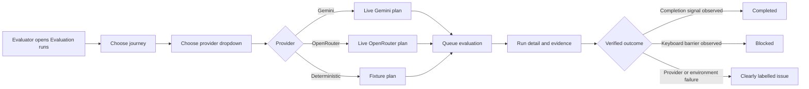
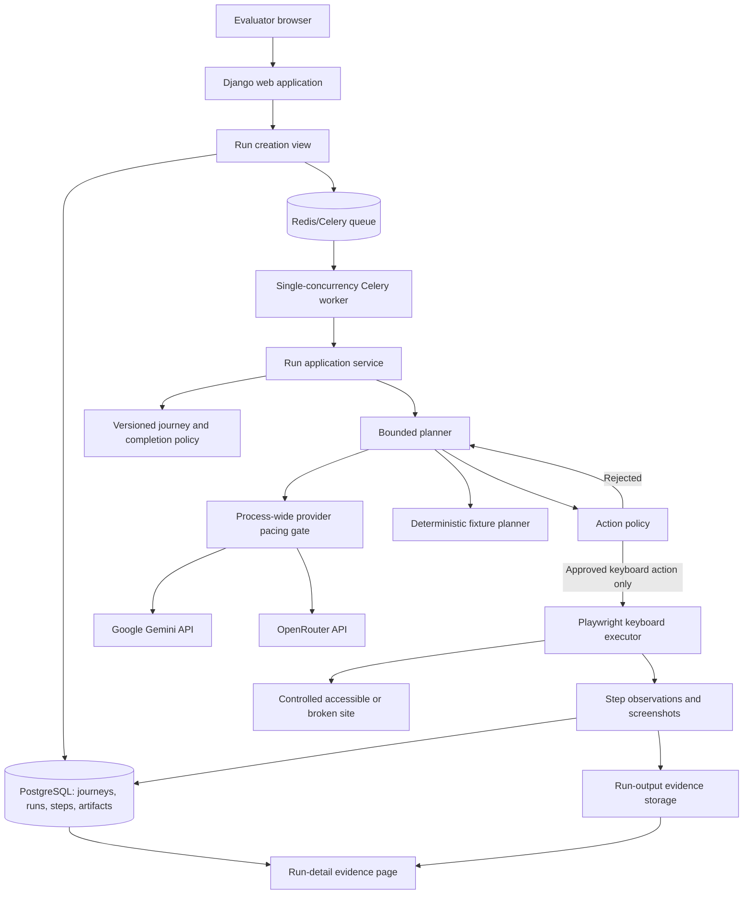
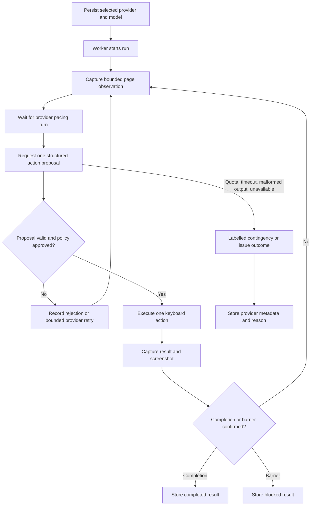

# AccessPath AI architecture and run flow

## What the system evaluates

AccessPath AI checks whether a declared appointment-booking journey can reach its declared completion state through keyboard-only input. The current Phase 1 scope covers motor accessibility on controlled fixture sites. A planner may propose one action at a time, but deterministic policy and the keyboard executor retain control of what can execute and whether the journey truly completed.

## User flow

## Backend architecture

## One evaluation run

## Provider reliability guardrails

- The UI records the selected provider and model with every run. A run never silently changes provider.
- The worker runs at one task at a time. The pacing gate also applies the configured interval across newly constructed clients, so a new run cannot immediately start another request to the same provider.
- Gemini and OpenRouter outcomes remain separate evidence sets. Deterministic runs are useful repeatable demonstrations but never count as live-model evidence.
- Completion requires the declared completion signal. A broken site with a keyboard barrier must remain `blocked`; it must never be reported as a completion.
- `openrouter/free` is suitable for smoke testing only because it can choose different upstream models. Repeatable evidence should use a preflight-verified, fixed model.
