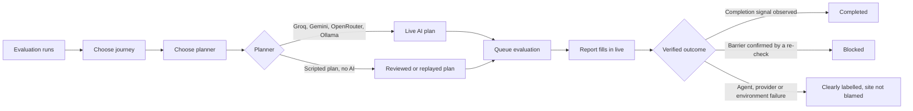
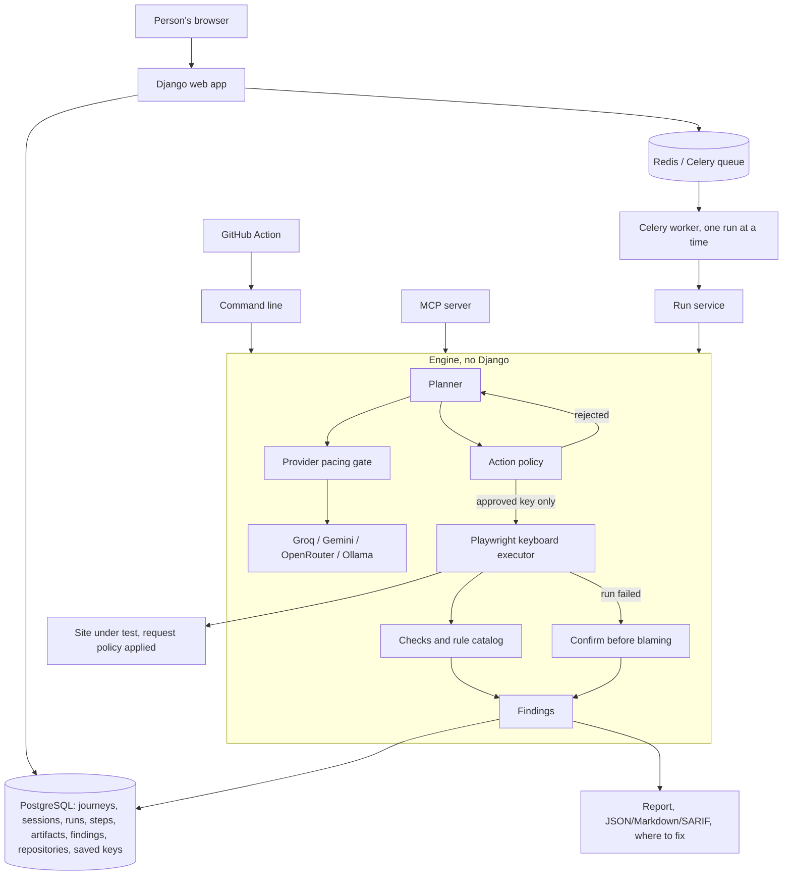
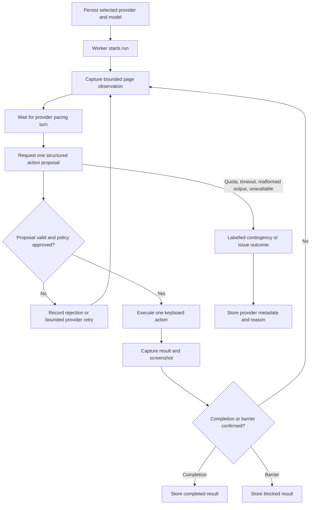
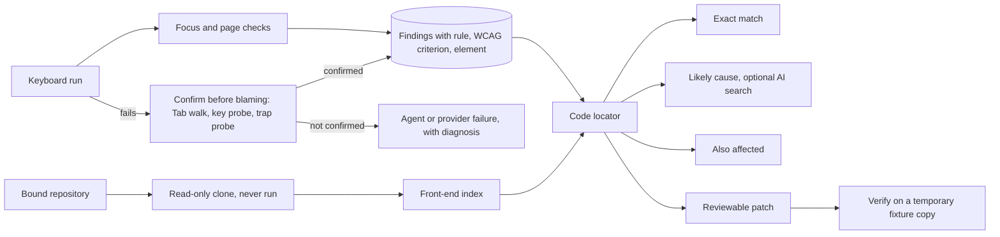

# AccessPath AI architecture and run flow

## What the system evaluates

AccessPath AI checks whether a declared journey, on the bundled demo site or a real website, can reach its declared completion state through keyboard-only input. The profile is motor accessibility. A planner (an AI provider, or a reviewed scripted plan) proposes one action at a time; deterministic policy and the keyboard executor keep control of what can execute and whether the journey truly completed. The same engine runs behind the web app, the command line, the GitHub Action and the MCP server.

## User flow (web app)

## Architecture

## One evaluation run

## Provider reliability guardrails

- The UI records the selected provider and model with every run. A run never silently changes provider.
- The worker runs at one task at a time. The pacing gate also applies the configured interval across newly constructed clients, so a new run cannot immediately start another request to the same provider.
- Each provider's results are separate evidence. Scripted runs are useful repeatable demonstrations but never count as live-model evidence.
- Completion requires the declared completion signal. A broken site with a keyboard barrier must remain `blocked`; it must never be reported as a completion.
- `openrouter/free` is suitable for smoke testing only because it can choose different upstream models. Repeatable evidence should use a preflight-verified, fixed model.

## October 2026: from a verdict to a fix

| Module | Responsibility |
|---|---|
| `rules/catalog.json`, `engine/rules.py` | Reviewed rule catalog (WCAG 2.2 + ACT IDs), presets, per-journey settings |
| `engine/checks.py` | Focus visible, focus obscured, unnamed controls, skip links, focus order, on-focus, axe-core |
| `engine/probes.py` | Tab walk, target probe, trap probe used to confirm a barrier |
| `engine/findings.py` | Collects findings, groups copies, applies ignores, gives every rule a result |
| `apps/runs/report.py` | One report for the page and the HTML/JSON exports |
| `engine/repo_clone.py`, `engine/code_index.py`, `engine/secret_scan.py` | Safe clone, front-end index, secret redaction |
| `engine/code_locator.py`, `engine/locator_ai.py` | Where to fix, patches, policy-bound AI search |
| `engine/fix_verify.py` | Re-run a journey against a patched temporary fixture copy |
| `apps/runs/benchmark.py` | Gate 1 measures over the benchmark journeys |

### Product pass (29 October 2026, stage 8)

| Module | Role |
|---|---|
| `engine/rules.py` (`CustomRuleV1`, `CUSTOM_CHECKS`) | Team rules: one of four fixed checks plus a CSS selector, stored in `Journey.rule_config["custom"]`, turned into catalog-shaped rules at run time |
| `engine/checks.py` (`_run_custom`) | Runs team rules once per page, using the page's Tab walk; an invalid selector is reported as not checked |
| `engine/fixture_site.py` | Serves the bundled demo site on its loopback address for a fixture run when nothing else answers there; copies it as the demo repository |
| `apps/codebase/demo.py`, `RepoBinding.source` | The bundled demo repository: analysed in-process, linked to the demo journeys, never cloned |
| `apps/runs/management/commands/demo_setup.py` | One command: demo account, journeys, demo repository, a team rule, scripted runs |
| `apps/core/setup_checks.py` | Shared by the Status page and `check_setup`: database, worker, browser, demo site, axe-core, git, storage, providers, secret key |
| `engine/executor.py` (`_route_web_socket`) | WebSockets follow the same origin policy as requests; a blocked socket is never connected |

### Release 1.0.0 (2 November 2026)

| Module | Role |
|---|---|
| `accesspath/cli.py`, `runner.py`, `report.py`, `journey_file.py` | Command line: journey files, runs without Django, JSON/Markdown/SARIF reports, exit codes, baselines |
| `accesspath/github.py`, `.github/actions/accesspath` | Pull-request comment and the composite GitHub Action |
| `accesspath/mcp_server.py` | MCP server over stdio for coding assistants |
| `accesspath/recorder.py` | `login` (save a signed-in session) and `record` (keys as a scripted plan) |
| `engine/session_state.py`, `apps/journeys/models.py` (`JourneySession`) | Saved sign-ins, encrypted, owner-only, cut to the journey's sites |
| `engine/target_policy.py` | Staging writes: POST only to the start site's origin and paths, within a budget, never redirected elsewhere |
| `apps/runs/services.py` (`persist_steps`) | Live progress: steps saved as they happen |
| `engine/provider_usage.py` | Token and prompt-cache use per run |
| `apps/runs/journey_tools.py` | Journey settings: sign-in, replay plan, baseline, staging writes, journey file |
| `extension/` | AccessPath Assist, the Chrome extension for keyboard and voice users |

