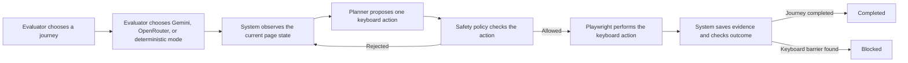

# AccessPath AI — Team Project Brief

**Use this document to explain the project simply and consistently.**  
**Current verified progress:** 33.5%  
**Current status:** The Phase 1 technical vertical slice is working and under final evidence review.

## 1. Problem statement

Many websites can appear usable but still prevent a person who relies on a keyboard from completing an important task. For example, a user may be able to open an appointment-booking page but may not be able to reach or activate the time-slot control using `Tab`, `Enter`, or other keyboard keys.

Manual accessibility review is important, but it is slow to repeat and hard to turn into clear step-by-step evidence. Existing automatic tools often check individual page elements. They do not always prove whether a complete user journey can actually be finished with a keyboard.

## 2. Our solution

AccessPath AI evaluates one declared user journey from start to finish using keyboard-only interaction.

The current system checks an appointment-booking journey. It can test:

- an accessible version of the journey, where booking should succeed; and
- a deliberately broken version, where a keyboard user cannot reach or operate the time-slot control.

The system records the actions, focus movement, screenshots, final outcome, and provider information. It only reports `completed` when a declared completion signal is actually observed. It reports `blocked` when it finds the defined keyboard barrier.

## 3. Who is the user?

The immediate users are:

- QA teams checking whether a web journey works with a keyboard;
- accessibility reviewers who need repeatable evidence;
- developers who need a clear reproduction trail for a keyboard issue; and
- project teams that need to demonstrate accessibility testing with evidence rather than only claims.

The current product is a controlled prototype for motor accessibility through keyboard input. It does not yet claim to test every accessibility need or every website.

## 4. How the system works

Important point for the presentation: the AI provider does **not** control the browser freely. It only proposes one action. Deterministic policy decides whether the action is safe, and the browser executor performs only approved keyboard actions.

## 5. What has been developed so far

### Working user interface

- Dashboard showing the available journeys and recent runs.
- Native dropdown for choosing Gemini, OpenRouter, or deterministic contingency mode.
- Run-detail page showing status, outcome, provider/model, step evidence, screenshots, hashes, and the final reason.
- Keyboard-accessible screenshot gallery.
- Recent evaluation runs can be filtered live by journey, planner, status, and outcome without losing the page position.

### Working accessibility-evaluation engine

- Keyboard-only browser execution with Playwright.
- Bounded allowed actions such as `Tab`, `Shift+Tab`, `Enter`, `Space`, arrow keys, and controlled text entry.
- Focus tracking and page-state observation after every action.
- Deterministic policy that blocks unsafe, unsupported, or wrongly targeted actions.
- Completion oracle that checks the declared booking-confirmation state.
- Broken-site control that correctly reports `blocked` rather than a false completion.
- The accessible fixture visibly identifies keyboard-reachable controls; the broken fixture visibly identifies its intentional keyboard barrier.

### Working backend and evidence

- Django application with PostgreSQL persistence.
- Redis and Celery for background evaluation runs.
- Durable records for runs, steps, planner metadata, screenshots, and SHA-256 hashes.
- Docker Compose environment with database, queue, fixture server, web application, and worker.

### AI/provider work

- Gemini structured-output planner.
- OpenRouter structured-output planner.
- Explicit provider selection and provider/model recording for every run.
- Error classification, bounded retries, and visibly labelled deterministic contingency behaviour.
- Cross-run pacing guard: the worker now keeps a minimum gap between consecutive requests to the same provider, even when a new run creates a new client.

### Quality and documentation

- 48 automated tests passed.
- Ruff linting, Pyright type checking, Django checks, and migration-drift checks passed.
- Browser review confirmed the provider dropdown and keyboard-accessible dashboard.
- Architecture diagrams, demo runbook, presentation outline, progress log, and teammate handoff are complete.

## 6. Evidence currently available

We already have two persisted live Gemini proof runs:

| Proof | Result | What it demonstrates |
|---|---|---|
| Accessible booking run `af03b14a-6700-4b91-a437-b8e3ada1de83` | `completed`, 29 calls, no fallback | One keyboard-only appointment booking reached the declared confirmation state. |
| Broken control run `cf0e9180-6cd1-4d08-a7f1-972eba776d56` | `blocked`, 13 calls, no fallback | The system detected the defined keyboard barrier and did not make a false completion claim. |

During the demo, open the run-detail pages, show two steps, open a screenshot, and show the provider metadata and final outcome. This proves the safety boundary, stored evidence, and correct negative control.

## 7. Current issues and honest limitations

### Current provider issue

The main remaining technical issue is live-provider reliability:

- Gemini has reached its available quota even when requests had a 15-second gap.
- OpenRouter's `openrouter/free` route returned one temporary Nvidia upstream-overload response and one length-limited response.
- These observed issues were not HTTP 429 rate-limit errors. Therefore, repeated use of the API key without a gap is not proven to be the root cause.

We improved the project by adding cross-run pacing. This reduces unnecessary back-to-back requests, but it cannot make an external free provider available or add quota.

### Current scope limitation

The current prototype covers:

- one appointment-booking journey family;
- keyboard/motor accessibility only;
- controlled accessible and broken fixture sites;
- local Docker deployment; and
- one user at a time.

It does not yet cover screen-reader use, visual accessibility checks, mobile applications, real production transactions, login flows, payment flows, cloud deployment, or full legal/WCAG conformance.

## 8. How to present the project

Use this simple story:

1. **Problem:** A user may be unable to complete an important web journey with a keyboard, even when the page looks normal.
2. **Solution:** AccessPath AI runs a declared journey with keyboard-only actions and stores proof of what happened.
3. **Safety:** AI suggests one action, while our deterministic policy and completion checks remain in control.
4. **Demo:** Show one successful accessible booking and one correctly blocked broken journey.
5. **Evidence:** Show screenshots, focus/action records, provider metadata, and final outcomes.
6. **Honesty:** Explain that provider quota and free-route availability remain external limitations, and that the final repeated live matrix is still pending.
7. **Future:** Explain how the current prototype grows into a broader accessibility-evaluation platform.

Do not say that the project has solved all accessibility testing. Say that it demonstrates an evidence-driven, keyboard-first journey evaluator.

## 9. Remaining Phase 1 work

1. Confirm with the mentor whether the final evidence must be Gemini-only or may use one fixed, preflight-verified live provider.
2. Select a fixed model. Do not use `openrouter/free` for final evidence because it can choose different upstream models.
3. Run one provider-pure final matrix: 3 accessible completions and 5 broken runs, with 0 false completions and no deterministic fallback counted as live evidence.
4. Record the final run IDs, model, provider, outcomes, fallback status, and limitation in the progress log.
5. Complete a second-person manual keyboard review.
6. Add team names, official presentation duration, and official rubric requirements.
7. Rehearse the presentation, perform a final Docker down/up rehearsal, run the quality suite, commit the demonstrated revision, and create the release tag after the exit review.

## 10. Longer-term next steps

### Product development

- Add more keyboard barriers and more journey types, such as login, registration, forms, validation recovery, and focus restoration.
- Add accessibility profiles for screen readers, visual checks, mobile, cognitive needs, documents, and other input methods.
- Add side-by-side rerun comparison and downloadable reports.

### Platform development

- Add authentication, teams, projects, and authorization.
- Add cloud artifact storage, secure access links, retention, and redaction.
- Add reliable distributed job handling, monitoring, logs, metrics, and deployment.
- Add CI/CD, security tests, stronger target-authorization controls, and production hardening.

### Evaluation and academic work

- Build a larger accessible/broken benchmark corpus.
- Measure precision, recall, false completions, false blocks, agreement, latency, and cost.
- Map supported checks clearly to WCAG and applicable compliance requirements.

## 11. Technology stack in simple terms

| Technology | Why we use it |
|---|---|
| Python and Django | Build the web application, dashboard, database models, and APIs. |
| PostgreSQL | Store journeys, run records, step evidence, metadata, and artifacts. |
| Redis and Celery | Run evaluations in the background so the web page remains responsive. |
| Playwright | Open the test website, use keyboard actions, track focus, and capture screenshots. |
| Pydantic | Keep the data exchanged between modules structured and validated. |
| Gemini and OpenRouter | Provide optional live AI action proposals. |
| Deterministic planner and policy | Keep the system safe, repeatable, and auditable. |
| Docker Compose | Start the complete local system consistently for development and demo. |
| pytest, Ruff, and Pyright | Test the code, find style issues, and check types. |
| Mermaid | Keep architecture and flow diagrams editable in Markdown. |

## 12. One-sentence conclusion

AccessPath AI is a working keyboard-first accessibility journey evaluator that combines bounded AI suggestions with deterministic safety checks and evidence, while remaining honest about current provider reliability and the broader work still needed for a complete accessibility platform.
